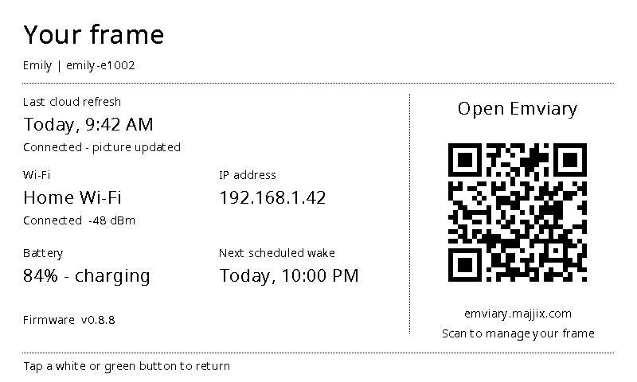
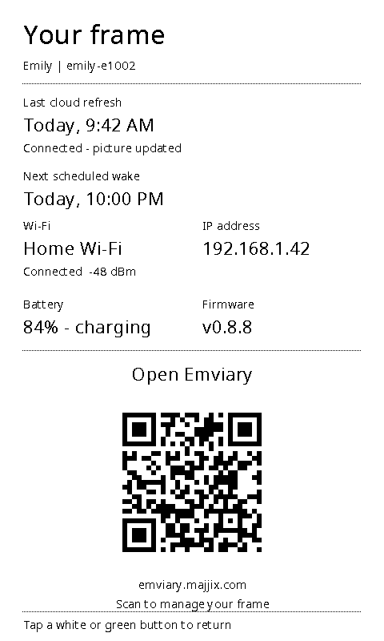

# On-frame status

Hold the left white button for five seconds to open the local status dashboard. Tap either white button or the green button to return to saved artwork. A short left tap continues to mean previous artwork.

The dashboard shows the last successful cloud refresh in the configured local timezone, last-check outcome, Wi-Fi and signal, current or clearly labeled last-known IPv4 address, battery/power state, next scheduled wake, firmware version, and local hostname. Its QR code opens https://emviary.majjix.com/.

It draws a temporary black-and-white overlay with crisp bitmap fonts and an integer-scaled QR with a four-module quiet zone. Landscape and portrait layouts share the same bounded renderer. Recovery's existing display-test text screen remains separate.

Opening status does not fetch artwork, connect Wi-Fi, enable logs, poll continuously, or write status to flash. Last successful refresh and network history are retained in RTC RAM across deep sleep. A full power loss clears that history; the screen says when a timestamp or address is unavailable rather than inventing one. Failed cloud attempts do not replace the last successful refresh time.

Returning to art uses the retained buffer or cached EPDGZ file. The overlay does not replace the stored artwork or modify its identity.

Sample host renders below use the actual C drawing geometry and fixture values.
They verify layout, not physical panel appearance. Their QR codes decode to the
exact public URL in both orientations, including after a 90-degree rotation.

